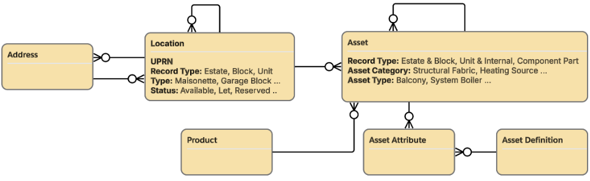

# Affordable Housing Core Data Model (AHA Core)

_**Future-proof your housing implementation by building on a standard, pre-built core data model.**_

[Accelerator Listing](https://gpsaccelerators.developer.salesforce.com/accelerator/a0wDo000001PRJCIA4/affordable-housing-core-data-model-aha-core)

## Description

Affordable Housing providers share a common need: a clean, consistent data foundation to build their Salesforce environment on. AHA Core delivers exactly that — a ready-made, standardised core data model for the housing sector, designed to be the **shared foundation that companion Accelerators and partner solutions build on top of**. Deploy it on day one and align your implementation to a common sector standard from the start.

Instead of spending weeks designing a bespoke schema, your organisation starts from a pre-mapped blueprint for the core Salesforce objects housing providers rely on. That shifts your team's effort away from foundational data architecture and onto what actually matters: delivering value to your residents and communities.

### Key Benefits
* **A shared industry standard**: AHA Core establishes a common data model for the housing sector — a single foundation that breaks down silos, makes data-sharing and alignment across organisations far simpler, and gives the whole ecosystem a consistent base to build on.
* **A platform for a growing ecosystem**: Because it's the standardised core, AHA Core is the layer that open-source companion Accelerators (such as Gas Safety, Complaints, and Managed Collections) and partner-built solutions can extend — so adopting it today positions you to plug in capabilities as they arrive.
* **Faster time to value**: Skip the lengthy architecture debates. A pre-built blueprint for core objects fast-tracks your implementation from the start.
* **Flexible, not prescriptive**: AHA Core is a starting point, not a constraint. Already have a schema that works? Keep it — and use mapping or transformation tools to bridge the gap. It ships with the data model and page layouts only, so you layer your own workflows onto a clean, standard base.

### What's Included
This first release focuses on the essentials — a standardised foundational data model plus basic UI layouts, with no business logic forced on you:
* **Asset Management**: Structures for tracking property and physical-asset portfolios.
* **Core People Management**: Clean configurations for Person Accounts, Accounts, and Contacts to relate stakeholders to assets accurately.

It intentionally does **not** include pre-built automations (Flows, validation rules), leaving you free to add your own on top of a clean, well-named foundation.

Built on predictable, clean naming conventions, AHA Core keeps your Salesforce environment organised, scalable, and ready to serve as the base for a growing roadmap of companion Accelerators and partner solutions. Whether you're kickstarting a brand-new implementation or aligning an existing one to an emerging sector standard, AHA Core gives you the foundation to build on. For technical detail, deployment packages, and the full naming schema, visit the GitHub repository.

> [!NOTE]
> AHA Core is a community- and industry-driven initiative. It is a collaborative framework and not an official Salesforce product.

> [!TIP]
> The [AHA Core Companion Accelerator](https://github.com/SFDO-Community-Sprints?q=housing&type=all) adds useful functionality such as asset viewers, maps, reports and other items that enhance functionality without being critical to the core schema.

## Key Assets

> [!IMPORTANT]
> This Accelerator only contains the metadata critical to deploying the core schema. This is intentional to avoid dependencies and complexity for those interested in the core schema only.

This Accelerator includes the following assets:
* An **unmanaged package**
  * The install link is found in the [Install Guide](docs/01_Install_Guide.md)
  * A copy of the package metadata is found in the [/force-app/main/default/](/force-app/main/default/) folder
  * For a summary of the metadata assets, see the [Contents](#package-contents) table
* **Documentation**, including:
  * This readme file
  * AI assistant instructions ([AGENTS.md](AGENTS.md))
  * Documentation located in the [/docs/](/docs/) folder:
    * [Install Guide](docs/01_Install_Guide.md)
    * [Install Guide for AI](docs/02_Install_Guide_for_AI.md)
    * [Design Guidance Philosophy](docs/03_Design_Guidance_Philosophy.md)

### Package Contents
    
| Type | Count | Members |
|---|---|---|
| CustomApplication | 1 | `AHA` |
| CustomField | 11 | `Asset`: `AHA_Asset_Category__c`, `AHA_Asset_Type__c`, `AHA_Parent_Block__c`, `AHA_Parent_Estate__c`, `AHA_Twin_Asset__c`, `AHA_UPRN__c` · `Location`: `AHA_Long_Description__c`, `AHA_Managed_By__c`, `AHA_Status__c`, `AHA_Twin_Asset__c`, `AHA_UPRN__c` |
| RecordType | 7 | `Asset`: `AHA_Block`, `AHA_Component`, `AHA_Estate`, `AHA_Unit` · `Location`: `AHA_Block`, `AHA_Estate`, `AHA_Unit` |
| CompactLayout | 7 | matching the record types above |
| Layout | 7 | `Asset` / `Location` page layouts |
| FlexiPage | 8 | 7 record pages + `AHA_UtilityBar` |
| ListView | 1 | `Location.All_Locations` |
| Flow | 2 | `AHA_Create_Twin_Asset` — record-triggered on `Location` create, creates the twin `Asset` · `AHA_Update_Asset_Parents` — record-triggered on `Asset` create/update, sets `AHA_Parent_Estate__c` / `AHA_Parent_Block__c` |
| RelationshipGraphDefinition | 2 | `AHA_Asset_Hierarchy`, `AHA_Locations_and_Assets_Hierarchy` — the hierarchy graphs the record-page `arcGraph` components render |
| QuickAction | 1 | `Asset.Update_Asset` |
| ValidationRule | 3 | `Asset.AHA_Location_Without_Twin_Asset` — if a Location is set, `AHA_Twin_Asset__c` must be checked · `Asset.AHA_Twin_Asset_Without_Location` — if `AHA_Twin_Asset__c` is checked, a Location must be set · `Asset.AHA_Restrict_Parent_Asset` — an Asset cannot have both a Parent Asset and a Location (cannot be a child and a twin at once) |
| PermissionSet | 1 | `AHA_Core` — grants the AHA app, full CRUD + View All/Modify All Records + View All Fields on Asset, Location, Account, and Contact, and editable FLS on the writable `AHA_*` and hierarchy link fields (`Asset.LocationId`, `Location.ParentLocationId`) |
| Profile | 1 | `Admin` (System Administrator) — classic page-layout assignments binding the 7 AHA record types to their AHA layouts; Lightning record pages are bound separately via the AHA app overrides |
| StandardValueSet | — | `LocationType` + `AssetStatus` — applied non-destructively via `scripts/merge-standard-valuesets.mjs`, **not** deployed in the package (see [Install Guide for AI §4a](docs/02_Install_Guide_for_AI.md)) |
  

## Before You Install

**License Requirements**
* Nonprofit Cloud or Public Sector Solutions for internal users.
* The AHA series of Accelerators generally assumes Nonprofit Cloud. This Accelerator requires an Industries license (e.g. Nonprofit Cloud or Public Sector Solutions) because the record pages use the Actionable Relationship Center (ARC) hierarchy component.
* **Platform and Service Cloud users are not supported**.

**Accelerator or Technology-Specific Assumptions**
* **Person Accounts** are enabled (see the detailed [installation instructions](docs/01_Install_Guide.md)).
* Your org is on **API version 63.0 or later** (Spring '25). The `AHA_Core` permission set uses the **View All Fields** object permission, which is only available from API 63.0.

**General Assumptions**
* You are using this Accelerator in a sandbox or test environment. It is recommended that you not install any Accelerator directly into production environments.
* If you do not have a Salesforce Nonprofit org licensed to you, try our industry solution for free with the [Nonprofit Cloud Trial](https://developer.salesforce.com/free-trials/comparison/nonprofit-cloud).
* You are using this Accelerator in conjunction with the Salesforce Lightning Experience (LEX) \- not the Classic UI.

## Installation

There are two ways to install AHA Core. **Your first step is to choose one:**

| | **Option A – Agentic Install (recommended)** | **Option B – Human-Driven Install** |
|---|---|---|
| **How it Works** | An AI coding assistant (Claude Code, Cursor, etc.) deploys the metadata to your org using the Salesforce CLI. The assistant checks the prerequisites and tells you if anything is missing. | You install the unmanaged package and configure it yourself in Setup |
| **Best For** | Anyone comfortable running an AI assistant and the Salesforce CLI (`sf`) | Admins who prefer a point-and-click install |
| **Your Role** | Meet the prerequisites, authorise the CLI to your org, and complete the few Setup-only steps the assistant asks you to do | Complete every step yourself |
| **Guide** | [Install Guide for AI](docs/02_Install_Guide_for_AI.md) | [Install Guide](docs/01_Install_Guide.md) |

**Option A – Agentic Install**

1. Clone this repo and open it in your AI assistant.
2. Authorise the Salesforce CLI to your sandbox: `sf org login web --alias <alias>`
3. Ask the assistant to install AHA Core into `<alias>`. It reads [AGENTS.md](AGENTS.md) and follows the [Install Guide for AI](docs/02_Install_Guide_for_AI.md), stopping to ask you whenever a step needs the Setup UI.

**Option B – Human-Driven Install**

1. Follow the [Install Guide](docs/01_Install_Guide.md) from start to finish, including its pre-install and post-install steps. The guide walks you through installing the unmanaged package.

## Post-Install Setup & Configuration

Post-install setup and configuration steps are covered by Agentic install (Option A) and the [Install Guide](docs/01_Install_Guide.md) (Option B).

  
## FAQs

***Q: Could I install using an AI assistant instead of the package?***

A: Yes, this is the recommended approach. See Option A under [Installation](#installation).

***Q: This Accelerator is only a schema, is there more?***

A: This is by design. We intentionally kept this as a bare-bones core schema only.  For additional capability see the [AHA Core Companion Accelerator](https://github.com/SFDO-Community-Sprints?q=housing&type=all) which contains enhanced Page Layouts and utilities such as Asset viewers, Paths, GeoMap LWCs and more. Give it a try and share your own content, too.

***Q: Why is the business process for  \<insert process name\> not included?***

A: This Accelerator intentionally does not address business processes. The Accelerator facilitates sharing of business processes by referencing a common schema design. You are encouraged to create and share your process, or any aspect of it, via the Affordable Housing Commons program. [https://sfdo-community-sprints.github.io/](https://sfdo-community-sprints.github.io/)

***Q: Is there guidance for extending the schema? I want to add an Asbestos Survey (or gas check etc).***

A: Yes\! See the [Design Guidance Philosophy](docs/03_Design_Guidance_Philosophy.md). Please consider sharing your creations via the Commons Program.

## Additional Resources

* [AHA Core Companion Accelerator](https://github.com/SFDO-Community-Sprints?q=housing&type=all)
* [Salesforce Accelerators](https://gpsaccelerators.developer.salesforce.com/all-accelerators)
* [Salesforce Open Source Commons Program](https://sfdo-community-sprints.github.io/)
* [Nonprofit Cloud Documentation](https://developer.salesforce.com/developer-centers/nonprofit-cloud)  
* [Salesforce Architects](https://architect.salesforce.com)

## Revision History

**1.0 Initial Release (22 Oct 2026\)** \- Initial release of the core schema/data model.

## Acknowledgements

* Builder: [Etienne de Klerk](https://www.linkedin.com/in/etiennedeklerk/), Principal Account Solution Engineer, Salesforce
* Builder: [Berthold Allgeier](https://www.linkedin.com/in/ballgeier/), Lead Technical Architect, Salesforce
* Tester: [Alastair Dutton](https://www.linkedin.com/in/alidutton/), Lead Account Solution Engineer, Salesforce

## Terms of Use

Thank you for using Salesforce Accelerators.  Accelerators are provided by Salesforce.com, Inc., located at 1 Market Street, San Francisco, CA 94105, United States.

By using this site and these accelerators, you are agreeing to these terms. Please read them carefully.

Accelerators are not supported by Salesforce, they are supplied as-is, and are meant to be a starting point for your organization. Salesforce is not liable for the use of accelerators.

For more about the Accelerator program, visit: [https://gpsaccelerators.developer.salesforce.com/](https://gpsaccelerators.developer.salesforce.com/)
