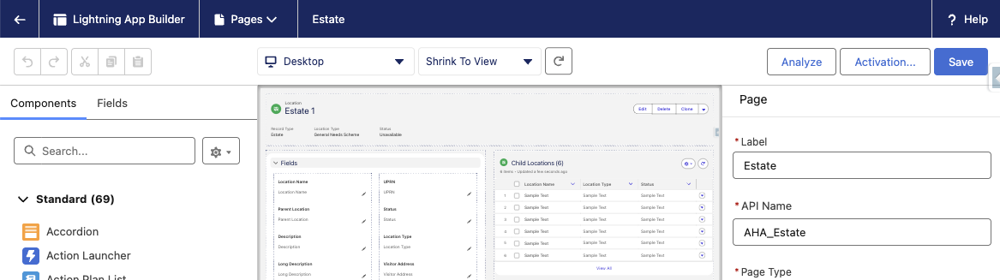
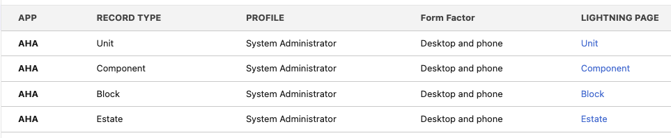
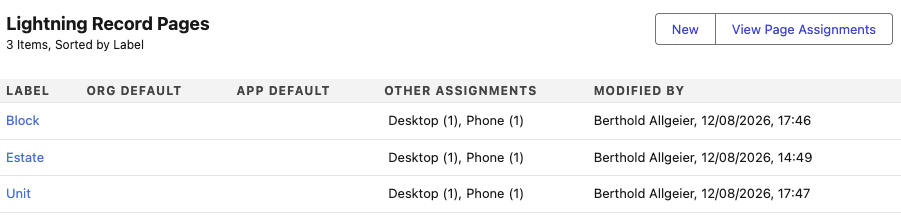
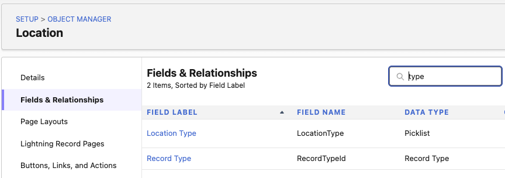
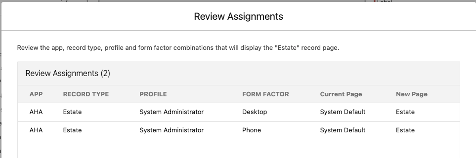
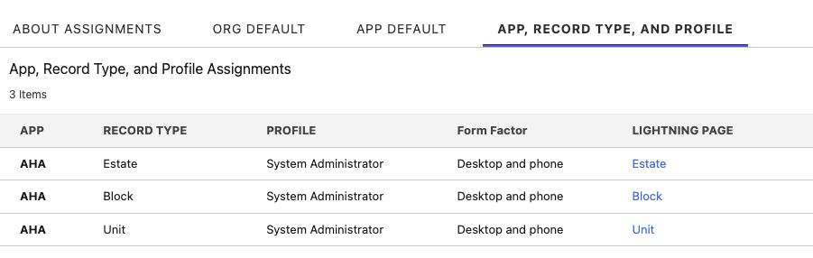

# Install Guide

Follow this guide to install the unmanaged package directly.  Alternatively, follow the [Install Guide for AI](02_Install_Guide_for_AI.md) for an easier, automated installation.

> [!IMPORTANT]
> Before you begin, read the [README](../README.md) for critical information and requirements (license requirements, assumptions, and prerequisites) that apply before installation.

---

## Pre-Installation

**Ensure the following are enabled *before* installation**.

### Step 1 - Enable the Lightning UI for your users
Confirm that all users, including system administrators, are using the Salesforce Lightning Experience (LEX), not the Classic UI.

### Step 2 - Enable Person Accounts
For instructions, please see our [documentation](https://help.salesforce.com/s/articleView?id=sales.account_person.htm&type=5).

### Step 3 - Add values to the Location Type Picklist (Location Object)
To install the Accelerator, it is required that the **Location Type** picklist field on the **Location** object is populated with the values below. The Record Types created for the Location object are configured to work with these values. Confirm you already have these values active in your picklists.

> [!NOTE]
> After installation, these values can be changed accordingly to your needs.

1. From Setup, Go to Object Manager → Location → Fields & Relationships. Then click on the **Location Type** field.
2. In the Location Type Picklist Values section, click New and copy/paste this values list (make sure when they paste that each value appears on its own line):
```
General Needs Scheme
Sheltered / Supported Housing Scheme
Extra Care Scheme
Mixed-Tenure Development
Temporary Accommodation Site
Commercial Zone
High-Rise Block
Low / Mid-Rise Block
Maisonette Block
Sheltered Facility Block
Garage Block
Communal Structure
Flat / Apartment
House
Maisonette
Bedsit / Studio / HMO Room
Garage / Parking Bay
Store Room / Shed
Communal Area Unit
```
3. Click Save.
4. Below are optional example values for your convenience, copy-paste to Location.LocationType



### Step 5 - Picklist - Status (Asset object)
To install the Accelerator, it is required that the **Status** picklist field on the **Asset** object is populated with the values below. The Record Types created for the Asset object are configured to work with these values. Confirm you already have these values active in your picklists.

> [!NOTE]
> After installation, these values can be changed accordingly to your needs.

1. From Setup, Go to Object Manager → Asset → Fields & Relationships. Then click on the **Status** field.
2. In the Status Picklist Values section, click New and copy/paste this values list (make sure when they paste that each value appears on its own line):
```
Active
Planned
Obsolete
```
3. Click Save.

---

## Installation

Install the unmanaged package in your Salesforce **[sandbox](https://test.salesforce.com/packaging/installPackage.apexp?p0=04td300000Lfdnh&isdtp=p1)** or **[production](https://login.salesforce.com/packaging/installPackage.apexp?p0=04td300000Lfdnh&isdtp=p1)** org. During the installation process, choose "Install for Admins Only" to ensure you only grant deliberate user access to the Accelerator by assigning the included permission set.

---

## Post-Installation

This Accelerator is distributed as an unmanaged package.
- Unmanaged packages allow you to freely access and modify the installed package contents.
- There are no upgrades; it's a one-off install.

Unmanaged package limitations require the following manual steps to be followed post-install.

### Step 1: Activate the Lightning Record Pages
There are seven Lightning Record Pages provided in the package, three for the Location object and another four for the Asset object. To be able to use them, the user Profile has to be assigned to these Record Types under the provided Custom App (AHA). Assuming your profile is System Admin, do the following:

1. In Setup, go to Object Manager → Location → Lightning Record Pages.
2. There are three Record Types: Estate, Block and Unit.
3. Click on Estate and then on Edit.
4. Click on the Activation button at the top right corner.



5. Click on the APP, RECORD TYPE, AND PROFILE tab.
6. Click on Assign to Apps, Record Types, and Profiles.
7. Select the AHA Lightning app only, then click Next.
8. Confirm the Form Factor as Desktop and phone, then click Next.
9. Select the Estate Record Type as that is the one that should be associated with this Lightning Record Page, then click Next.
10. Select your Profile, in this example System Administrator. Then click Next.
11. Review your assignments. They should look like to the image below:



12. Click on Save.
13. Click on the Back arrow of the Lightning App Builder to return to the Object Manager.
14. Click on Lightning Record Pages again to do the same for the Block and Unit ones. Repeat steps 3 to 13 for each one, changing Estate to Block or Unit.
15. For the Asset Lightning Record Pages, do the same by accessing Object Manager → Asset → Lightning Record Pages and following steps 3 to 13\.
16. You can always check the assignment by clicking on the View Page Assignments button. The assignments for Location and Asset should look like this:



### Step 2 - Activate Location Object Record Pages
Repeat the above procedure to activate the **Location** object record pages:



### Step 3 - Activate Asset Object Record Pages
Repeat the above procedure to activate the **Asset** object record pages:



### Step 4 - Assign the Permission Set
Enable access to the newly installed metadata by assigning the **AHA Core** permission set (API name `AHA_Core`) to your user.

The permission set grants full rights to the **Account**, **Contact**, **Asset**, and **Location** objects (including all fields and record types), together with visibility of the AHA app and its tabs.
