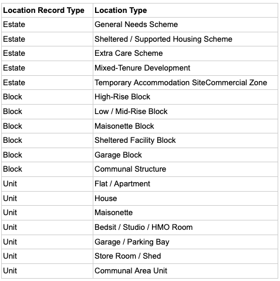
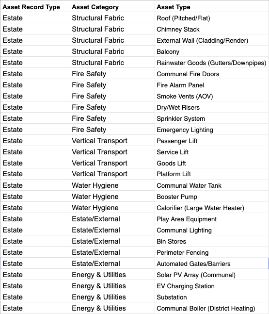
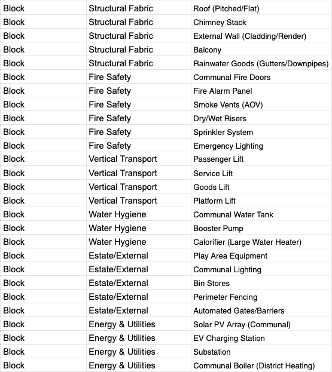
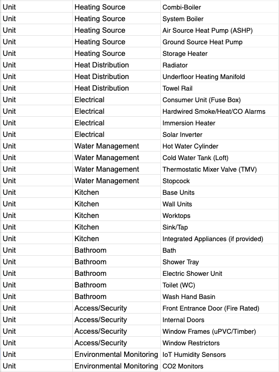
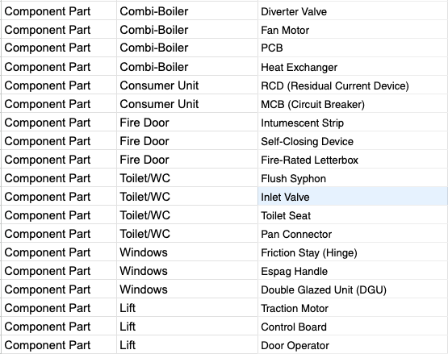

# Design Guidance Philosophy

<h2>Data Model</h2>
This first release of AHA (Affordable Housing Accelerator) provides the data model to support property and asset hierarchy. 

The **Location** standard object models every possible property, using three record types that are based on the property hierarchy level. These types are: Estate, Block and Unit. Along with the record types, the LocationType (standard field) is used to define the property type, as described in the following table. 

The **Asset** standard object represents all items that need to be maintained as part of a property inventory list and subject to service and/or compliance. Four record types have been defined, aligned with the property hierarchy:
 
- Estate: assets that are linked to properties of type Estate
- Block: assets that are linked to properties of type Block
- Unit: assets that are linked to properties of type Unit
- Component: assets that are parts of other assets, such as boiler parts, etc.

> _Note: the former combined "Estate & Block" record type was split into separate **Estate** and **Block** record types, to better represent the typical housing-estate hierarchy and accommodate the differing child assets at each level._

Along with the record types, two custom fields, Asset Category and Asset Type, have been created to define the asset category and type, as described in the following table. 

The data model optionally offers the **Asset Attribute** and **Asset Definition** to extend the asset attributes if needed. This is useful for asset type specific attributes that are only used in some assets. Using **Asset Attribute** records alleviates the number of fields you create in the **Asset** object. The **Asset Definition** standard object defines the type of an **Asset Attribute**.

The **Address** object works along with the **Location** object, in a many to many relationship. In most cases, one Location just has one defined **Address**. However, there are big locations such as an Estate or Block where the location has many addresses.

The **Product** standard object is used for those **Asset** records that refer to a commercial product. **Product** specific attributes should be defined here rather than in the Asset object.
